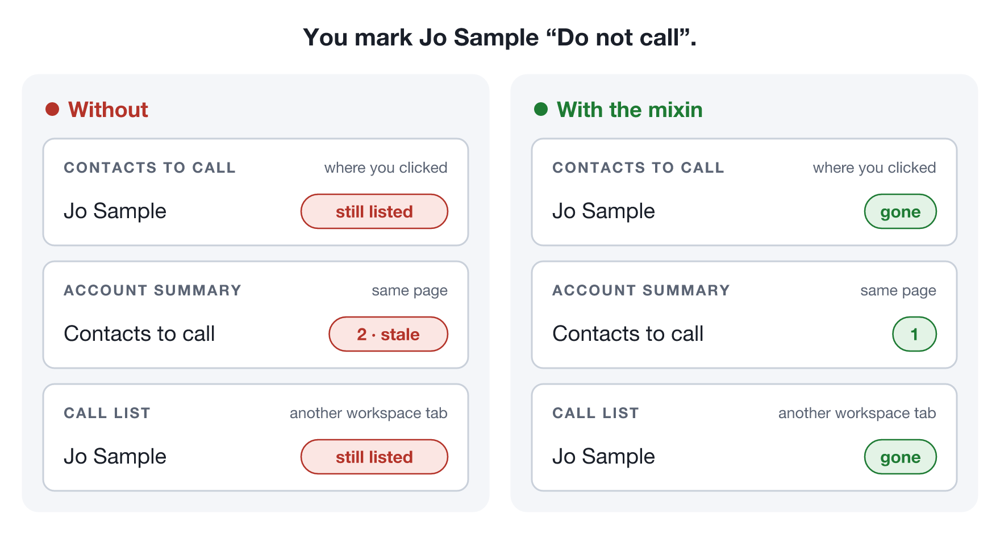
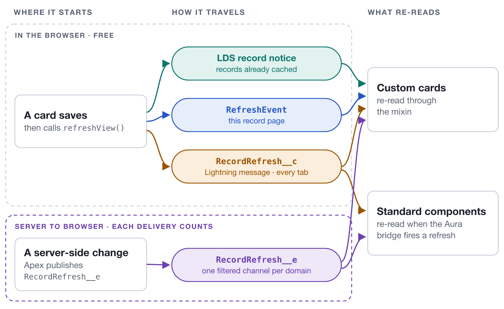
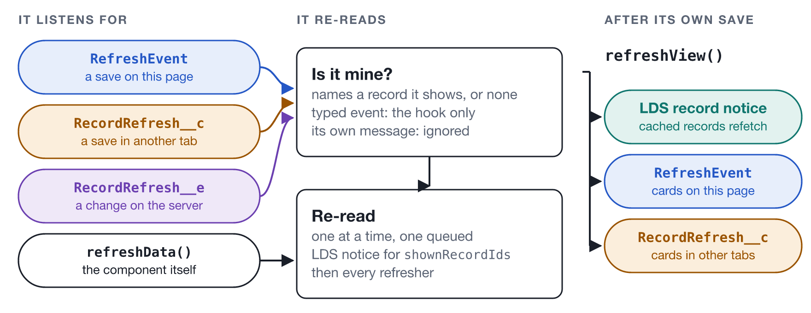
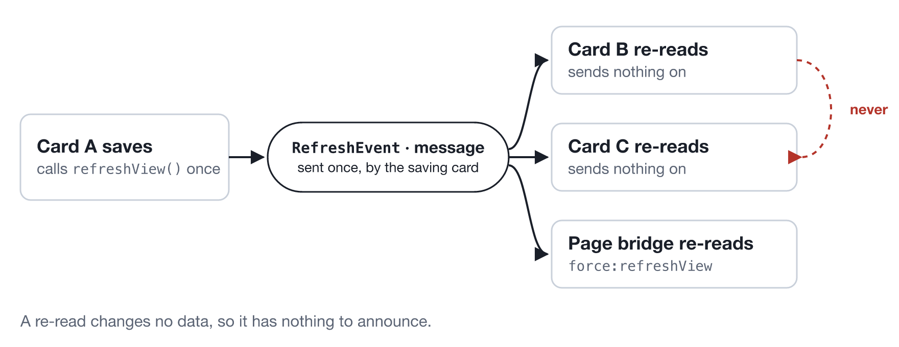
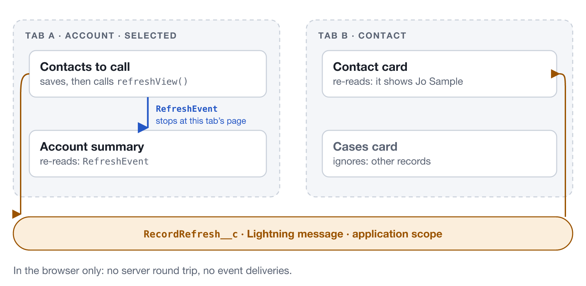
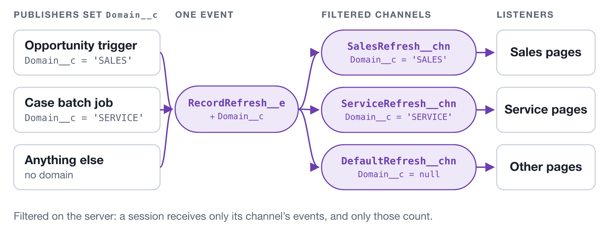
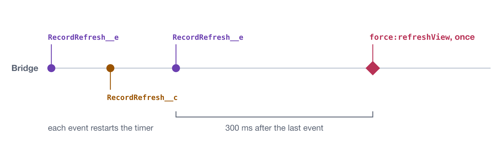

# Fresh by default: one mixin for every custom LWC

_Cache, saves, sibling cards, console tabs and server changes, wired once._



With Claude Code and similar tools, a custom Lightning web component now takes about as long as adding a field section to a record page. So record pages are filling up with custom components.

That speed has a cost. Standard components look after their own data; custom ones don’t. Save in one card and the card beside it still shows the old value. So does the same record open in another console tab, and every page that was open when a batch job or another user changed the record. Users reload, and soon stop trusting the page.

In [Force the refresh of record page](https://hugolemos.medium.com/force-the-refresh-of-record-page-283f1243d641) I used a platform event to refresh one record page. This post turns that idea into one mixin that every data component extends, so fresh data is the default rather than something each component reinvents.

**What you get**

- **Fresh data without a reload.** After the component’s own save, a save in the card beside it, a save in another console tab, or a change made on the server.
- **Two getters per component.** Extend `RefreshableData`, then list the records the component shows and the functions that re-read them. The cache, events, subscriptions and clean-up live in one tested place.
- **No loops, no wasted reads.** Refreshes can’t chain, and a burst of signals costs at most two reads. Nothing polls, which the docs [advise against](https://developer.salesforce.com/docs/platform/lwc/guide/reference-graphql-refresh.html).
- **Easy on allocations.** Signals inside the browser never touch the [event delivery allocation](https://developer.salesforce.com/docs/platform/platform-events/guide/platform-events-limits-default.html). Server events travel on filtered channels, so a page receives, and is [counted for](https://developer.salesforce.com/docs/platform/platform-events/guide/platform-events-filter-allocations.html), only its own domain’s events.
- **Standard components too.** A small Aura bridge refreshes them when the page’s record changes.
- **A rule generated code can follow.** When an AI tool writes your next component, “extend the mixin and fill in two getters” is one line in your CLAUDE.md.

## Five signals



- **LDS record notice.** [`notifyRecordUpdateAvailable`](https://developer.salesforce.com/docs/platform/lwc/guide/reference-notify-record-update.html) tells Lightning Data Service that records changed outside it, through Apex for example. Wires that use those records get fresh data. LDS writes need no notice: LDS [keeps the data it manages in sync](https://developer.salesforce.com/docs/platform/lwc/guide/data-ui-api.html), but not data from Apex.
- **The wire’s `refresh()`.** The GraphQL wire adapter caches query results and [hands each result a `refresh` function](https://developer.salesforce.com/docs/platform/lwc/guide/reference-graphql-refresh.html) that re-runs the query. LDS updates a changed record inside cached results, but [doesn’t re-check the query’s filter](https://developer.salesforce.com/docs/platform/graphql/guide/graphql-wire-lwc-refresh.html): a record that no longer matches stays listed until `refresh()`. Apex wires have [`refreshApex()`](https://developer.salesforce.com/docs/platform/lwc/guide/apex-result-caching.html).
- **`RefreshEvent`.** Part of the [RefreshView API](https://developer.salesforce.com/docs/platform/lwc/guide/data-refreshview-api.html). It bubbles to the nearest refresh container, the record page, which calls every refresh handler registered beneath it.
- **A Lightning message.** With [application scope](https://developer.salesforce.com/docs/platform/lwc/guide/use-message-channel-scope.html), it reaches subscribers anywhere in the app, including console workspace tabs that aren’t selected.
- **A platform event.** The only signal that starts on the server. Components receive it through [`lightning/empApi`](https://developer.salesforce.com/docs/platform/lightning-component-reference/guide/lightning-emp-api.html).


## One mixin



`RefreshableData` wires all of this into one class. A component extends it and overrides two getters. Here’s the example from the repo, a card listing an account’s contacts who can be called:

```js
export default class AccountContactsCard extends RefreshableData(LightningElement) {
    @api recordId;
    contacts;
    refreshContacts;

    @wire(graphql, { query: CONTACTS_TO_CALL, variables: '$variables' })
    wiredContacts({ data, refresh }) {
        this.refreshContacts = refresh;
        // map data to this.contacts
    }

    get refreshers() {
        return [this.refreshContacts];
    }

    get shownRecordIds() {
        return [this.recordId, ...(this.contacts ?? []).map((contact) => contact.id)];
    }

    async handleDoNotCall(event) {
        await updateRecord({ fields: { Id: event.target.dataset.id, DoNotCall: true } });
        this.refreshView();
    }
}
```

- `refreshers`: the functions that re-read the component’s data. Each GraphQL `refresh`, or `() => refreshApex(this.wired)`.
- `shownRecordIds`: the records it shows. Incoming signals are matched against them; outgoing ones name them.
- `refreshView()`: call it after the component’s own save. It sends the LDS notice, a `RefreshEvent` and the message.
- Overriding `connectedCallback` or `disconnectedCallback`? Call `super` first.

“Do not call” writes through LDS, so the contact’s values update everywhere. The list’s filter isn’t re-checked, though, so the contact would stay listed. `refreshView()` re-runs this list and every other one that shows the contact.

Three details from the docs:

- Message scope works [only with `@wire(MessageContext)`](https://developer.salesforce.com/docs/platform/lwc/guide/use-message-channel-scope.html), so the mixin declares that wire itself. `createMessageContext()` is [for service components](https://developer.salesforce.com/docs/platform/lightning-component-reference/guide/lightning-message-service.html).
- A refresh handler must [resolve to a Boolean](https://developer.salesforce.com/docs/platform/lwc/guide/reference-lightning-refreshview-registerrefreshhandler.html): `true` lets the refresh carry on to child components. The mixin’s does.
- The code assumes Lightning Web Security. Orgs still on Lightning Locker [register with `this.template.host` and a bound handler](https://developer.salesforce.com/docs/platform/lwc/guide/reference-lightning-refreshview-registerrefreshhandler.html).

## Refreshes don’t chain



Only a save sends a refresh. A received refresh only re-reads. So one save reaches every listener directly and stops there: no chains, no loops.

The mixin enforces it:

- `refreshView()` called while the component handles a refresh sends nothing. It logs an error and reads once more instead.
- Received refreshes share reads: one runs, one waits. One save arriving three ways costs at most two reads.
- Never call `refreshView()` from a wire handler, `refreshData()` or the event hook. And don’t write on page load: a write that publishes events could loop through the server.

The price: a save that finishes while its card is mid-read isn’t announced. The card itself still re-reads.

## Across console tabs



A `RefreshEvent` follows DOM bubbling and [stops at the nearest refresh container](https://developer.salesforce.com/docs/platform/lwc/guide/data-refreshview-api.html). A card in another workspace tab sits under a different record page, so it never hears it. That’s my reading of the docs, which don’t mention console tabs.

So `refreshView()` also publishes on the `RecordRefresh__c` message channel. Each subscriber checks whether it shows one of the named records, and ignores its own messages.

The message stays in the browser: no server round trip and no event deliveries. Lightning message service works [across the DOM within a Lightning page](https://developer.salesforce.com/docs/platform/lwc/guide/use-message-channel.html), so another browser window, or another user, still needs the platform event.

## Server changes: one event, a channel per domain



When a batch job, a callout or another user changes a record, the browser can’t know. Apex publishes `RecordRefresh__e`:

```apex
EventBus.publish(new RecordRefresh__e(RecordId__c = opportunity.Id, Domain__c = 'SALES'));
```

- The event publishes after commit, so it’s [published only once the transaction succeeds](https://developer.salesforce.com/docs/platform/platform-events/guide/platform-events-define-ui.html). Listeners never re-read uncommitted data.
- Every event [delivered to a browser counts](https://developer.salesforce.com/docs/platform/platform-events/guide/platform-events-limits-default.html) against the org’s daily delivery allocation, and a browser on a channel receives every event on it.
- So `Domain__c` picks a [custom channel](https://developer.salesforce.com/docs/platform/platform-events/guide/platform-events-subscribe-custom-channels.html), and each channel has a filter. A session receives only its channel’s events, and the allocation [counts what’s delivered after the filter](https://developer.salesforce.com/docs/platform/platform-events/guide/platform-events-filter-allocations.html). Custom channels need a high-volume event.
- Filters can [compare a field with `null`](https://developer.salesforce.com/docs/platform/platform-events/guide/platform-events-filter-considerations.html), so `DefaultRefresh__chn` carries the events with no domain.

```xml
<PlatformEventChannelMember xmlns="http://soap.sforce.com/2006/04/metadata">
    <eventChannel>SalesRefresh__chn</eventChannel>
    <filterExpression>Domain__c = 'SALES'</filterExpression>
    <selectedEntity>RecordRefresh__e</selectedEntity>
</PlatformEventChannelMember>
```

A component picks its channel:

```js
get refreshChannel() {
    return REFRESH_CHANNELS.SALES;
}
```

- A blank `RecordId__c` is a broadcast: every listener on the channel re-reads.
- `Type__c` turns an event into a notification. It goes only to `onRecordRefreshEvent(payload)`, unless the component lists the type in `refreshOnEventTypes`. One channel can then carry “the document is ready” without every card re-querying.
- Listening needs [Read on the event](https://developer.salesforce.com/docs/platform/platform-events/guide/platform-events-intro-emp.html); the repo has a permission set for it. And `lightning/empApi` [runs in desktop browsers only](https://developer.salesforce.com/docs/platform/lightning-component-reference/guide/lightning-emp-api.html).
- A domain is a string in three places: the publisher, the channel filter and `REFRESH_CHANNELS`. A typo reaches no one, silently.

## Standard components: the Aura bridge



Standard components don’t listen on your channels, and the docs don’t list which of them respond to a `RefreshEvent`. In my testing, the Activity component didn’t.

The Aura event [`force:refreshView`](https://developer.salesforce.com/docs/platform/lightning-component-reference/guide/force-refresh-view.html) reloads the standard components on a record page. It’s an Aura event, so the bridge, `c:refreshViewBridge`, is a small Aura component:

- It renders nothing. Put it last in the page’s sidebar, where it leaves no gap.
- It listens on the channel you pick in Lightning App Builder (a [design attribute](https://developer.salesforce.com/docs/platform/aura-platform/guide/components-config-for-app-builder-design-files.html)) and to the message.
- It fires only for an untyped event that names its record. A broadcast would reload every open record page.
- It merges a burst into one refresh, 300 ms after the last event: the docs say [repeated firing isn’t supported](https://developer.salesforce.com/docs/platform/lightning-component-reference/guide/force-refresh-view.html).

`force:refreshView` is labelled beta and [affects performance](https://developer.salesforce.com/docs/platform/lightning-component-reference/guide/force-refresh-view.html). Add the bridge only where a standard component needs it; custom components refresh themselves.

## Get the code

```
force-app/main/default/
├── lwc/refreshableData/            the mixin and its Jest tests
├── lwc/accountContactsCard/        the example and its Jest tests
├── aura/refreshViewBridge/         the force:refreshView bridge
├── objects/RecordRefresh__e/       the event: RecordId__c, Type__c, Domain__c
├── platformEventChannels/          a channel per domain
├── platformEventChannelMembers/    their filters
├── messageChannels/                RecordRefresh__c
└── permissionsets/                 Read on the event
```

The repo is at ‹repo link›. Deploy with `sf project deploy start --source-dir force-app`, then run `npm install && npm test`.

Extend one mixin, override two getters and call `refreshView()` after a save. Nobody needs to reload.
